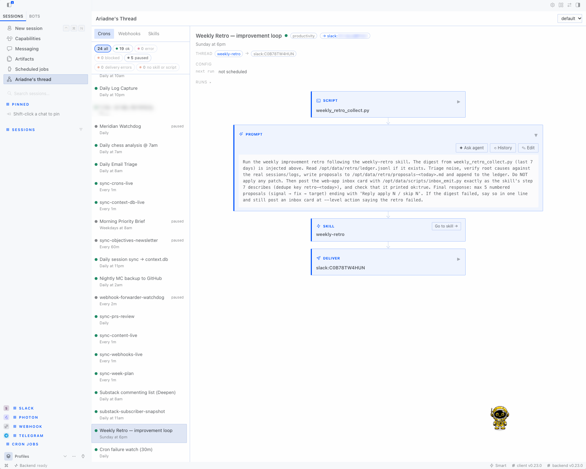
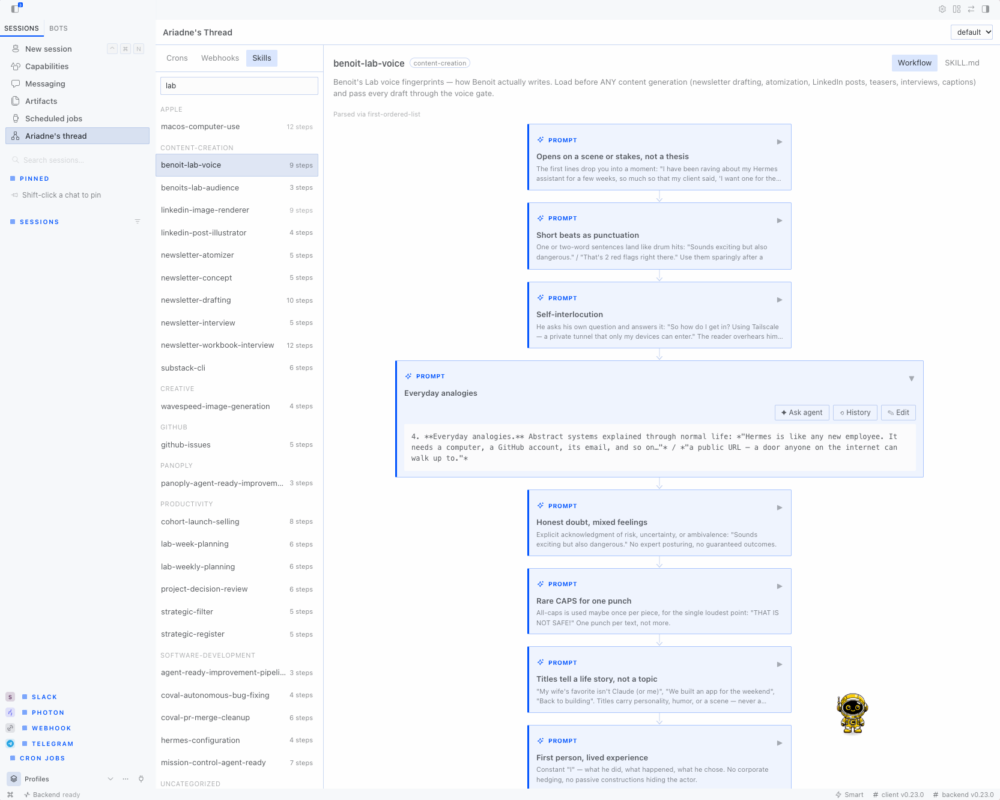
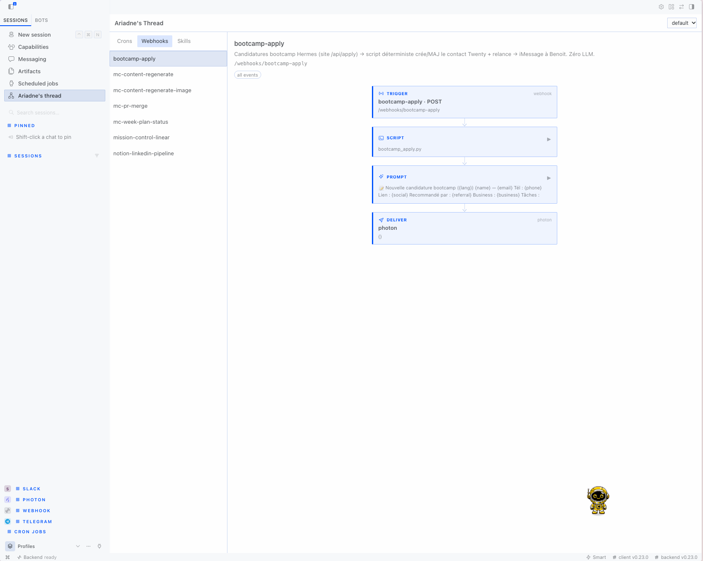

# Ariadne's Thread

n8n-style flows for your Hermes skills and crons.

Ariadne's Thread adds a page to Hermes Desktop that draws each cron job, webhook route, and skill as a chain of steps. A cron shows its script, prompt, attached skills, and delivery target. A skill shows the steps it describes, read from its `SKILL.md`. Open any step to read it, edit it right there, or draft a change request for it in a new chat.







## Install

Ariadne's Thread needs Hermes 0.22.0 or later.

Install it from the plugin catalog:

```sh
hermes plugins install ariadne-thread
```

Until the catalog entry exists, install it from its [GitHub repository](https://github.com/benoit-dev/ariadne-thread). Pin a full commit SHA:

```sh
hermes plugins install benoit-dev/ariadne-thread --ref <40-character commit sha>
```

Hermes installs plugins disabled. To enable it, answer yes to the prompt or run:

```sh
hermes plugins enable ariadne-thread
```

Restart Hermes Desktop, or rescan plugins, so that it loads the Desktop page. The backend API mounts when the Hermes backend starts.

## Use it

Open **Ariadne's Thread** in the Desktop sidebar. The page has three tabs.

- **Crons** lists the jobs in `cron/jobs.json` with their status and schedule. Select a job to see its flow.
  - A health bar at the top counts jobs that are ok, in error, blocked, paused, with a delivery error, and with no skill or script. It also counts **other** and **never run** jobs when there are any. Click a count to show only those jobs, and click it again to show all.
  - The status is the scheduler's own `last_status`. A status other than `ok` shows next to the job's name exactly as Hermes wrote it, such as `blocked_config` or `delivery_failed`. A status the plugin does not know is never shown as ok. A job that has not run yet shows `never`.
  - The selected job lists its problems: the last error, how many runs in a row have failed, why and since when it is paused, and the last delivery error.
  - **Config** shows when the job runs next (relative and as a date), then its `model`, `provider`, `enabled_toolsets`, `profile`, `workdir`, `context_from`, `repeat` and `no_agent`, when set. It never shows `base_url`, and it hides any value that looks like a key, a token, or a URL with a password in it.
  - **Thread** shows the skills the job loads and where its output goes. Click a skill to open it.
  - **Runs** lists the latest output files Hermes saved for the job in `cron/output/<job id>/`, with their time and size. Click one to read it. At most the first 256 KB is shown.
- Click a step to expand it in place: a script step widens to show the script file from `scripts/`, a prompt step shows the whole prompt, and the deliver step lists each target in `deliver` as stored and flags one that sends nothing, such as a platform with no home channel. Which platforms have a home channel comes from Hermes' own `/api/cron/delivery-targets`. A job that only saves its output ends in a **local** deliver step. Click it again to collapse it. A skill step does not expand; its **Go to skill** button opens the skill.
- **Webhooks** lists the routes from Hermes' own `/api/webhooks`, with their events and flow. That endpoint never returns a route's secret. Its steps open the same way.
- **Skills** lists the skills in your skills folder and in any folder listed under `skills.external_dirs`, grouped by category folder, with a step count. A selected skill has two views: **Workflow** shows its flow, its related skills, and **Used by**, which lists every cron and webhook that loads the skill with the cron's status and where each one delivers. **SKILL.md** shows the whole file.

Use the profile menu in the header to look at another profile. Other profiles are read-only. Skills from `skills.external_dirs` are also read-only and show an **external** badge. If a local skill and an external skill have the same name, the local one wins, as it does in Hermes.

### Edit in place

An expanded step has an **Edit** button. It turns the step into a text box; **Save** (or ⌘/Ctrl+Enter) writes it, **Cancel** (or Esc) drops it. What you can edit:

- a skill step: the lines of `SKILL.md` that step came from. The rest of the file is left as it was, and the whole file must still pass the frontmatter checks.
- the whole `SKILL.md`, from the **SKILL.md** view.
- a cron job's prompt.
- a script step's file in `scripts/`, unless it is over 256 KB.
- a cron job's delivery targets. Pick from local, the origin chat and the platforms your gateway has set up (⚠ marks one with no home channel yet), or type the comma-separated `deliver` value, such as `telegram,discord:1234`. Enter saves.

Scripts show with line numbers and syntax colours (Python, shell and JavaScript, picked by extension or shebang), and edit in a code editor: Tab and Shift+Tab indent or dedent the selected lines, Enter keeps the line's indent (one level more after a Python `:` or an opening bracket), and Backspace in leading spaces removes one indent level.

When you edit a skill, the line next to **Save** says what the change reaches, such as "Saving affects 3: daily-digest, triage, gh-issues", or that no cron or webhook uses the skill.

Each save sends the text you started from. If the file changed since (a cron run, an agent, another window), the save is refused and nothing is written; reload and try again. Trigger steps and webhook deliver steps are read-only. A webhook prompt is read-only too, because Hermes has no endpoint yet to change one field of a route; its **Ask agent** button drafts the change for a chat instead.

### Undo an edit

Before each save, Ariadne's Thread keeps a copy of the text it is about to replace. This covers a whole `SKILL.md`, one skill step, a script, a cron prompt, and a cron's delivery targets. A skill step edit keeps the whole `SKILL.md`. The last 10 copies of each are kept, and older ones are deleted.

An editable step has a **History** button next to **Edit**. It lists the saved copies by time. Pick one to see a diff against the current text, then click **Revert to this version** to write it back. A revert is a save, so it goes through the same checks: it is refused if the text changed since you opened the diff, and it keeps a copy of the text it replaces, so you can undo the revert too. History is available in the active profile only.

### Ask an agent

Every editable step also has an **Ask agent** button next to **Edit**. It docks a request box at the bottom of the step's visible area that stays in view while you scroll (Esc closes it). The skill has a box for the whole file under its views. Type the request (the box grows to fit it; Shift+Enter adds a line) and press Enter or click the send arrow. Ariadne's Thread opens a new chat with a prompt that names the file or job, quotes the step's current text, and adds your request. Nothing runs until you send that message. If the draft cannot be placed, the prompt goes to your clipboard.

### How skills become flows

The parser reads step headings (`## Step 1`), an ordered list under a heading such as "Procedure" or "Steps", or the first ordered list in the skill. If it finds none, it shows each `##` section as a step, or the whole skill as one step. The flow view says which rule it used. [docs/parsing-report.md](docs/parsing-report.md) shows the results on every skill that ships with Hermes and lists where the parser is weak.

## What this plugin reads and writes

Ariadne's Thread reads files that Hermes keeps in its home folder (`HERMES_HOME`, `~/.hermes` by default). The only data of its own is the edit history in `plugin-data/ariadne-thread/history/` inside that folder. This is the per-plugin folder Hermes sets aside for plugins.

It reads:

- `cron/jobs.json`
- the run output files in `cron/output/<job id>/`, when you open a job's **Runs**. It lists only files named like `2026-11-08_09-00-00.md`, refuses any path that resolves outside that job's folder, and shows at most the first 256 KB.
- the webhook routes and the cron delivery platforms, from Hermes' own `GET /api/webhooks` and `GET /api/cron/delivery-targets`. The Desktop page calls them through the Desktop bridge (`window.hermesDesktop.api`), because the plugin SDK only reaches the plugin's own API. Both are read-only, and `/api/webhooks` returns no secrets. The plugin never opens `webhook_subscriptions.json` itself.
- every `SKILL.md` under `skills/`, including skill folders that are symlinks to shared folders
- `config.yaml`, only to find `skills.external_dirs`, and every `SKILL.md` in those folders
- a script in `scripts/` when you click a script step, the same folder Hermes runs cron and webhook scripts from. It refuses paths that resolve outside that folder and shows at most the first 256 KB. The script is shown as it is, so anything written into it is visible on screen.
- the folder names in `profiles/`, and the same sources inside a profile when you pick it
- its own history files in `plugin-data/ariadne-thread/history/`, when you open **History**

It writes only when you click **Save**, and only in the active profile:

- a skill's `SKILL.md`, whole or one step's lines, through a temporary file in the same folder. Only skills whose real path is inside `skills/`; never external skill folders.
- a script in `scripts/`, through a temporary file, keeping its file mode. Paths outside `scripts/` are refused.
- a cron job's `prompt`, through Hermes' own cron store (`cron.jobs.update_job`), which takes the same lock as the scheduler.
- a cron job's `deliver`, through the same cron store.
- before each of these writes, one history file in `plugin-data/ariadne-thread/history/<kind>/<hash of the target>/`. It holds the replaced text, its kind and target name, and the time. It is written through a temporary file with mode `0600` in folders with mode `0700`. The plugin keeps the newest 10 per target and deletes older ones. If the history file cannot be written, the save is refused and nothing changes.

A revert from **History** writes through the same paths as a save.

Every save is refused if the text on disk no longer matches what you started editing.

To clear the history, delete `plugin-data/ariadne-thread/`. Uninstalling the plugin does not delete it.

It does not:

- run shell commands or start processes
- run, pause, or resume cron jobs. **Runs** only reads the output files Hermes already wrote.
- start agent sessions or send messages for you
- call any network service other than the Hermes backend it is installed in
- read credentials, `.env` files, or tokens, or enter another profile's secret scope
- collect telemetry

Hermes has no public plugin seam for editing a cron job, so the backend imports `cron.jobs` (`get_job` and `update_job`) for the cron prompt and delivery edits. A Hermes release can change it. [docs/risk-audit.md](docs/risk-audit.md#core-imports) explains what happens if it goes away.

After a save, it sends the local event `plugin.ariadne-thread.skills.changed` to open Desktop windows so that they refresh.

[docs/risk-audit.md](docs/risk-audit.md) lists each of these with its file and line.

## Development

Run the tests with a Python that has Hermes installed:

```sh
python -m pytest tests
```

Check the package the same way catalog CI does:

```sh
hermes plugins validate . --install-deps
hermes plugins doctor . --ci
```

[docs/validation.md](docs/validation.md) has the output for this version.

### Try external skill folders by hand

1. Create a folder with one skill in it:

    ```sh
    mkdir -p ~/team-skills/ops/rotate-logs
    printf -- '---\nname: rotate-logs\ndescription: Rotate old logs\n---\n\n1. Find logs older than 7 days.\n2. Compress them.\n' > ~/team-skills/ops/rotate-logs/SKILL.md
    ```

2. Add the folder to `~/.hermes/config.yaml`:

    ```yaml
    skills:
      external_dirs:
        - ~/team-skills
    ```

3. Open the **Skills** tab. `rotate-logs` appears under `ops` with 2 steps and an **external** badge, and it has no **Edit** button.

4. Run `hermes skills list` and check that Hermes lists the same skill.

## License

MIT. See [LICENSE](LICENSE).
